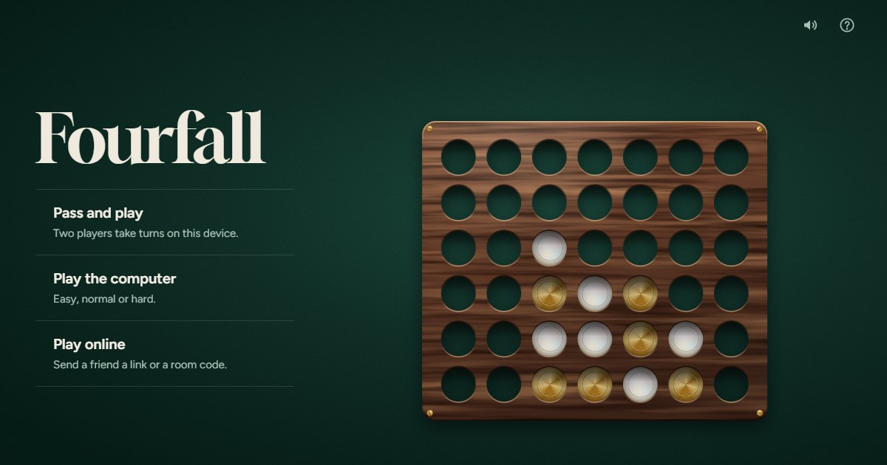

# Fourfall

Four in a row in the browser, on a walnut board with brass and pearl discs.

**Play:** https://fsiuhgshiqoih32.github.io/fourfall/



## Ways to play

- **Pass and play:** two players take turns on one device. Undo is available.
- **Play the computer:** easy, normal or hard. The hard level searches ahead for about a second per move.
- **Play online:** create a room and send a friend the link or the six-character code. Rematches alternate who moves first, and a game survives a page reload.

Keys: Left and Right choose a column, Enter or Space drops a disc, 1 to 7 drop straight into a column, U undoes.

## How online play works

There is no game server. Both players connect to three public MQTT relays over secure WebSockets (EMQX, HiveMQ and Mosquitto test brokers) and send every message to all of them, so one relay going down doesn't stop a game. Each message is a full snapshot of the game (game number, who moved first, the move list), re-sent every few seconds, so a lost message fixes itself. Each player can only add moves for their own colour, and the room creator decides when a new game starts.

Moves and names travel through public servers that anyone can listen to, so don't put anything private in your name.

## Running it locally

It's plain HTML, CSS and JavaScript modules with no build step. Serve the folder with any static server, for example:

```bash
python -m http.server 8765
```

Then open http://localhost:8765/.

## Files

- `js/game.js`: the rules (pure functions)
- `js/ai-worker.js`: the computer player (negamax with alpha-beta pruning, in a worker)
- `js/board-view.js`: the board, disc animations and input
- `js/online.js`, `js/mqtt-lite.js`: online rooms and a small MQTT client
- `js/sound.js`: synthesised sounds, no audio files
- `js/main.js`: screens and game flow

## Credits

- Fonts: [Gloock](https://github.com/duartp/gloock) and [Figtree](https://github.com/erikdkennedy/figtree), both under the SIL Open Font License 1.1 (see `fonts/`).
- Code: MIT licence (see `LICENSE`).
